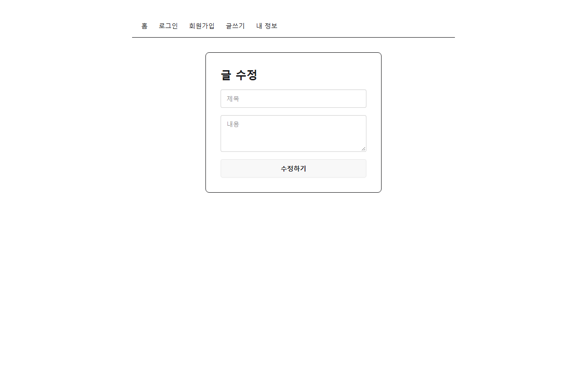

# 그림완성

3 screens 화면 그리기와 라우트까지 끝낸 코드다.
시작 키트를 react-blog 폴더로 복사한 뒤 아래 순서대로 한다.

## 지울 것

- src/app/router.jsx
- src/features/auth/JoinForm.jsx
- src/features/auth/LoginForm.jsx
- src/features/board/BoardItem.jsx
- src/features/board/Detail.jsx
- src/features/board/Home.jsx
- src/features/board/Home.test.jsx
- src/features/board/SaveForm.jsx
- src/features/board/UpdateForm.jsx
- src/features/reply/ReplyForm.jsx
- src/features/reply/ReplyItem.jsx
- src/features/user/MyInfoForm.jsx
- src/features/user/MyInfoForm.test.jsx
- src/shared/components/ErrorFallback.jsx
- src/shared/components/Header.jsx
- src/shared/components/Header.test.jsx
- src/shared/components/Layout.jsx
- src/shared/dummy/db.js
- src/shared/dummy/DummyProvider.jsx
- src/test/setup.js

## 붙여 넣을 파일

파일 내용을 통째로 바꾼다. 없는 파일은 만든다.

#### package.json

```json
{
  "name": "react-blog-modern-start",
  "private": true,
  "version": "1.0.0",
  "type": "module",
  "scripts": {
    "dev": "vite",
    "build": "vite build",
    "preview": "vite preview",
    "test": "vitest run",
    "format": "prettier --write src"
  },
  "dependencies": {
    "@hookform/resolvers": "^3.9.0",
    "@reduxjs/toolkit": "^2.8.2",
    "@tanstack/react-query": "^5.59.0",
    "@tanstack/react-query-devtools": "^5.59.0",
    "axios": "^1.11.0",
    "jwt-decode": "^4.0.0",
    "lucide-react": "^0.454.0",
    "react": "^19.1.1",
    "react-dom": "^19.1.1",
    "react-hook-form": "^7.53.0",
    "react-redux": "^9.2.0",
    "react-router-dom": "^7.8.1",
    "sonner": "^1.5.0",
    "zod": "^3.23.8",
    "zustand": "^5.0.0"
  },
  "devDependencies": {
    "@tailwindcss/vite": "^4.0.0",
    "@testing-library/jest-dom": "^6.8.0",
    "@testing-library/react": "^16.3.0",
    "@testing-library/user-event": "^14.5.2",
    "@vitejs/plugin-react": "^4.3.1",
    "daisyui": "^5.0.0",
    "eslint": "^9.12.0",
    "@eslint/js": "^9.12.0",
    "eslint-config-prettier": "^9.1.0",
    "eslint-plugin-react-hooks": "^5.0.0",
    "eslint-plugin-react-refresh": "^0.4.12",
    "globals": "^15.11.0",
    "jsdom": "^25.0.0",
    "msw": "^2.4.0",
    "prettier": "^3.3.3",
    "tailwindcss": "^4.0.0",
    "vite": "^5.4.0",
    "vitest": "^2.1.0"
  }
}
```

#### vite.config.js

```js
import { defineConfig } from "vite";
import react from "@vitejs/plugin-react";
import tailwindcss from "@tailwindcss/vite";

export default defineConfig({
  plugins: [react(), tailwindcss()],
  server: { port: 5173 },
});
```

#### src/components/Header.jsx

```jsx
import { NavLink } from "react-router-dom";

export default function Header() {
  return (
    <ul className="menu menu-horizontal">
      <li>
        <NavLink to="/" end>
          홈
        </NavLink>
      </li>
      <li>
        <NavLink to="/login-form">로그인</NavLink>
      </li>
      <li>
        <NavLink to="/join-form">회원가입</NavLink>
      </li>
      <li>
        <NavLink to="/save-form">글쓰기</NavLink>
      </li>
      <li>
        <NavLink to="/user-info">내 정보</NavLink>
      </li>
    </ul>
  );
}
```

#### src/components/Layout.jsx

```jsx
import { Outlet } from "react-router-dom";
import Header from "./Header";

export default function Layout() {
  return (
    <div className="max-w-3xl mx-auto p-8">
      <Header />
      <hr className="mb-8" />
      <Outlet />
    </div>
  );
}
```

#### src/pages/Detail.jsx

```jsx
import { Link } from "react-router-dom";

export default function Detail() {
  return (
    <div>
      <h1 className="text-2xl font-bold">제목1</h1>
      <p>작성자 ssar</p>
      <p className="my-8">내용1</p>
      <div className="flex gap-2">
        <Link to="/update-form/1" className="btn">
          수정
        </Link>
        <button className="btn">삭제</button>
      </div>

      <hr className="my-8" />

      <h2 className="font-bold">댓글</h2>
      <ul className="list">
        <li className="list-row">
          <span>cos</span>
          <span>댓글1</span>
          <button className="btn btn-ghost btn-xs">🗑</button>
        </li>
        <li className="list-row">
          <span>love</span>
          <span>댓글2</span>
          <button className="btn btn-ghost btn-xs">🗑</button>
        </li>
      </ul>
      <form className="flex gap-2 mt-4">
        <input className="input flex-1" placeholder="댓글을 입력하세요" />
        <button className="btn">등록</button>
      </form>
    </div>
  );
}
```

#### src/pages/Home.jsx

```jsx
import { Link } from "react-router-dom";

export default function Home() {
  return (
    <div className="grid grid-cols-3 gap-8">
      <div className="card border">
        <div className="card-body">
          <Link to="/board/1">제목1</Link>
        </div>
      </div>
      <div className="card border">
        <div className="card-body">
          <Link to="/board/2">제목2</Link>
        </div>
      </div>
      <div className="card border">
        <div className="card-body">
          <Link to="/board/3">제목3</Link>
        </div>
      </div>
    </div>
  );
}
```

#### src/pages/JoinForm.jsx

```jsx
export default function JoinForm() {
  return (
    <form className="card border max-w-sm mx-auto p-8 gap-4">
      <h1 className="text-2xl font-bold">회원가입</h1>
      <input className="input" placeholder="아이디" />
      <input className="input" type="password" placeholder="비밀번호" />
      <input className="input" placeholder="이메일" />
      <button className="btn">가입하기</button>
    </form>
  );
}
```

#### src/pages/LoginForm.jsx

```jsx
export default function LoginForm() {
  return (
    <form className="card border max-w-sm mx-auto p-8 gap-4">
      <h1 className="text-2xl font-bold">로그인</h1>
      <input className="input" placeholder="아이디" />
      <input className="input" type="password" placeholder="비밀번호" />
      <button className="btn">로그인</button>
    </form>
  );
}
```

#### src/pages/SaveForm.jsx

```jsx
export default function SaveForm() {
  return (
    <form className="card border max-w-sm mx-auto p-8 gap-4">
      <h1 className="text-2xl font-bold">글쓰기</h1>
      <input className="input" placeholder="제목" />
      <textarea className="textarea" placeholder="내용" />
      <button className="btn">글쓰기</button>
    </form>
  );
}
```

#### src/pages/UpdateForm.jsx

```jsx
export default function UpdateForm() {
  return (
    <form className="card border max-w-sm mx-auto p-8 gap-4">
      <h1 className="text-2xl font-bold">글 수정</h1>
      <input className="input" placeholder="제목" />
      <textarea className="textarea" placeholder="내용" />
      <button className="btn">수정하기</button>
    </form>
  );
}
```

#### src/pages/UserInfo.jsx

```jsx
export default function UserInfo() {
  return (
    <form className="card border max-w-sm mx-auto p-8 gap-4">
      <h1 className="text-2xl font-bold">내 정보</h1>
      <input className="input" value="ssar" readOnly />
      <input className="input" placeholder="이메일" />
      <input className="input" type="password" placeholder="새 비밀번호" />
      <button className="btn">수정하기</button>
    </form>
  );
}
```

#### src/index.css

```css
@import "tailwindcss";
@plugin "daisyui";

.menu .active {
  @apply menu-active;
}
```

#### src/main.jsx

```jsx
import { StrictMode } from "react";
import { createRoot } from "react-dom/client";
import "./index.css";
import App from "./App";

createRoot(document.getElementById("root")).render(
  <StrictMode>
    <App />
  </StrictMode>,
);
```

#### src/App.jsx

```jsx
import { BrowserRouter, Routes, Route } from "react-router-dom";
import Layout from "./components/Layout";
import Home from "./pages/Home";
import Detail from "./pages/Detail";
import SaveForm from "./pages/SaveForm";
import UpdateForm from "./pages/UpdateForm";
import LoginForm from "./pages/LoginForm";
import JoinForm from "./pages/JoinForm";
import UserInfo from "./pages/UserInfo";

export default function App() {
  return (
    <BrowserRouter>
      <Routes>
        <Route path="/" element={<Layout />}>
          <Route index element={<Home />} />
          <Route path="board/:id" element={<Detail />} />
          <Route path="save-form" element={<SaveForm />} />
          <Route path="update-form/:id" element={<UpdateForm />} />
          <Route path="login-form" element={<LoginForm />} />
          <Route path="join-form" element={<JoinForm />} />
          <Route path="user-info" element={<UserInfo />} />
        </Route>
      </Routes>
    </BrowserRouter>
  );
}
```

## 이렇게 보이면 된다

react-blog 폴더에서 npm run dev를 하고 화면을 연다.





다음은 따라치기.md의 4 component-split부터 이어 친다.
