# server-node와 통신하는 React 블로그 라이브코딩 따라치기

## 1 project-setup 출발점 (강의 전 준비)

### 1. start를 react-blog로 복사하기

왜: 설치된 라이브러리를 그대로 쓰려면 start를 복사해야 한다
실행하면: npm run dev로 start의 옛 화면이 그대로 뜬다

코드는 치지 않는다. 시작 키트를 react-blog 폴더로 복사한다.

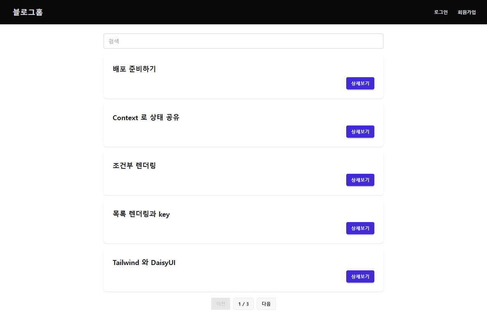

### 2. 옛 코드를 지우고 Hello World 띄우기

왜: 강의는 빈 화면에서 시작해야 학생이 모든 코드를 직접 쓴다
실행하면: 흰 바탕에 큰 굵은 글자로 Hello World만 보인다

#### vite.config.js

```diff
@@ -5,9 +5,4 @@ import tailwindcss from "@tailwindcss/vite";
 export default defineConfig({
   plugins: [react(), tailwindcss()],
   server: { port: 5173 },
-  test: {
-    environment: "jsdom",
-    globals: true,
-    setupFiles: "./src/test/setup.js",
-  },
 });
```

지운다: src/app/router.jsx

지운다: src/features/auth/JoinForm.jsx

지운다: src/features/auth/LoginForm.jsx

지운다: src/features/board/BoardItem.jsx

지운다: src/features/board/Detail.jsx

지운다: src/features/board/Home.jsx

지운다: src/features/board/Home.test.jsx

지운다: src/features/board/SaveForm.jsx

지운다: src/features/board/UpdateForm.jsx

지운다: src/features/reply/ReplyForm.jsx

지운다: src/features/reply/ReplyItem.jsx

지운다: src/features/user/MyInfoForm.jsx

지운다: src/features/user/MyInfoForm.test.jsx

지운다: src/shared/components/ErrorFallback.jsx

지운다: src/shared/components/Header.jsx

지운다: src/shared/components/Header.test.jsx

지운다: src/shared/components/Layout.jsx

지운다: src/shared/dummy/db.js

지운다: src/shared/dummy/DummyProvider.jsx

지운다: src/test/setup.js

#### src/main.jsx

```diff
@@ -1,14 +1,10 @@
-import React from "react";
-import ReactDOM from "react-dom/client";
-import { RouterProvider } from "react-router-dom";
+import { StrictMode } from "react";
+import { createRoot } from "react-dom/client";
 import "./index.css";
-import { router } from "./app/router";
-import { DummyProvider } from "./shared/dummy/DummyProvider";
+import App from "./App";
 
-ReactDOM.createRoot(document.getElementById("root")).render(
-  <React.StrictMode>
-    <DummyProvider>
-      <RouterProvider router={router} />
-    </DummyProvider>
-  </React.StrictMode>
+createRoot(document.getElementById("root")).render(
+  <StrictMode>
+    <App />
+  </StrictMode>,
 );
```

#### src/App.jsx

```jsx
export default function App() {
  return <h1 className="text-3xl font-bold">Hello World</h1>;
}
```


### 3. 포맷 명령 더하기

왜: 따라 친 코드의 모양을 한 번에 맞춘다
실행하면: npm run format으로 src 파일 모양이 맞춰진다

#### package.json

```diff
@@ -7,7 +7,8 @@
     "dev": "vite",
     "build": "vite build",
     "preview": "vite preview",
-    "test": "vitest run"
+    "test": "vitest run",
+    "format": "prettier --write src"
   },
   "dependencies": {
     "@hookform/resolvers": "^3.9.0",
```


## 2 layout 레이아웃과 헤더

### 1. 라우터로 홈 화면 띄우기

왜: 주소마다 화면을 바꾸려면 라우터가 먼저 있어야 한다
실행하면: / 에 홈 글자가 보인다. Hello World는 사라진다

#### src/pages/Home.jsx

```jsx
export default function Home() {
  return <h1>홈</h1>;
}
```

#### src/App.jsx

```diff
@@ -1,3 +1,12 @@
+import { BrowserRouter, Routes, Route } from "react-router-dom";
+import Home from "./pages/Home";
+
 export default function App() {
-  return <h1 className="text-3xl font-bold">Hello World</h1>;
+  return (
+    <BrowserRouter>
+      <Routes>
+        <Route path="/" element={<Home />} />
+      </Routes>
+    </BrowserRouter>
+  );
 }
```


### 2. 레이아웃에 헤더 메뉴 두기

왜: 모든 화면에 같은 헤더를 두려면 화면이 바뀌는 자리를 레이아웃 안에 따로 둬야 한다
실행하면: 메뉴 5개 아래에 홈이 보이고 로그인을 누르면 주소가 /login-form으로 바뀐다

#### src/components/Header.jsx

```jsx
import { NavLink } from "react-router-dom";

export default function Header() {
  return (
    <ul className="menu menu-horizontal">
      <li>
        <NavLink to="/">홈</NavLink>
      </li>
      <li>
        <NavLink to="/login-form">로그인</NavLink>
      </li>
      <li>
        <NavLink to="/join-form">회원가입</NavLink>
      </li>
      <li>
        <NavLink to="/save-form">글쓰기</NavLink>
      </li>
      <li>
        <NavLink to="/user-info">내 정보</NavLink>
      </li>
    </ul>
  );
}
```

#### src/components/Layout.jsx

```jsx
import { Outlet } from "react-router-dom";
import Header from "./Header";

export default function Layout() {
  return (
    <div>
      <Header />
      <Outlet />
    </div>
  );
}
```

#### src/App.jsx

```diff
@@ -1,11 +1,14 @@
 import { BrowserRouter, Routes, Route } from "react-router-dom";
+import Layout from "./components/Layout";
 import Home from "./pages/Home";
 
 export default function App() {
   return (
     <BrowserRouter>
       <Routes>
-        <Route path="/" element={<Home />} />
+        <Route path="/" element={<Layout />}>
+          <Route index element={<Home />} />
+        </Route>
       </Routes>
     </BrowserRouter>
   );
```


### 3. 바깥 여백과 구분선 주기

왜: 화면 가장자리에 글자가 붙지 않아야 읽기 쉽다
실행하면: 메뉴와 홈이 가운데 너비 안에 여백을 두고 놓이고 사이에 선이 생긴다

#### src/components/Layout.jsx

```diff
@@ -3,8 +3,9 @@ import Header from "./Header";
 
 export default function Layout() {
   return (
-    <div>
+    <div className="max-w-3xl mx-auto p-8">
       <Header />
+      <hr className="mb-8" />
       <Outlet />
     </div>
   );
```

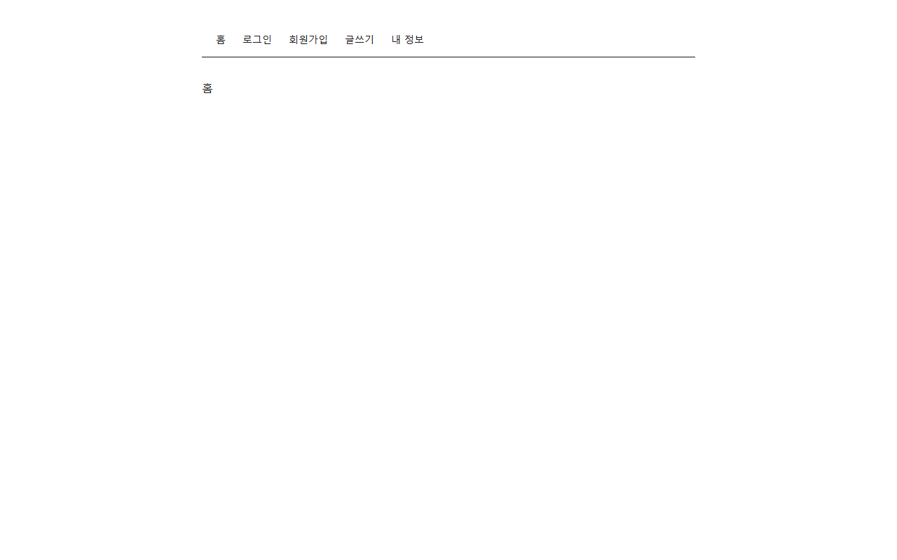

### 4. 지금 메뉴 강조하기

왜: 지금 어느 화면에 있는지 메뉴만 보고 알 수 있다
실행하면: 홈 메뉴가 검정 바탕으로 칠해진다

#### src/components/Header.jsx

```diff
@@ -4,7 +4,9 @@ export default function Header() {
   return (
     <ul className="menu menu-horizontal">
       <li>
-        <NavLink to="/">홈</NavLink>
+        <NavLink to="/" end>
+          홈
+        </NavLink>
       </li>
       <li>
         <NavLink to="/login-form">로그인</NavLink>
```

#### src/index.css

```diff
@@ -1,2 +1,6 @@
 @import "tailwindcss";
 @plugin "daisyui";
+
+.menu .active {
+  @apply menu-active;
+}
```

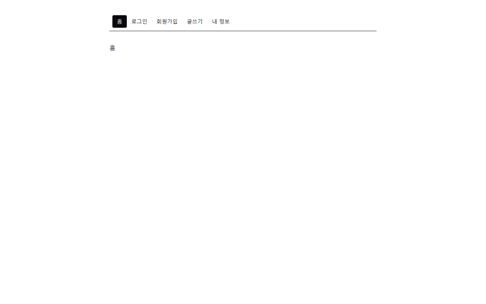

## 3 screens 화면 그리기와 라우트

### 1. 홈에 글 카드 3개 놓기

왜: 글 목록 자리를 먼저 그려야 뒤 장에서 서버 글로 바꿀 수 있다
실행하면: 홈에 제목1, 제목2, 제목3 카드가 세 칸으로 보인다

#### src/pages/Home.jsx

```diff
@@ -1,3 +1,15 @@
 export default function Home() {
-  return <h1>홈</h1>;
+  return (
+    <div className="grid grid-cols-3 gap-8">
+      <div className="card border">
+        <div className="card-body">제목1</div>
+      </div>
+      <div className="card border">
+        <div className="card-body">제목2</div>
+      </div>
+      <div className="card border">
+        <div className="card-body">제목3</div>
+      </div>
+    </div>
+  );
 }
```

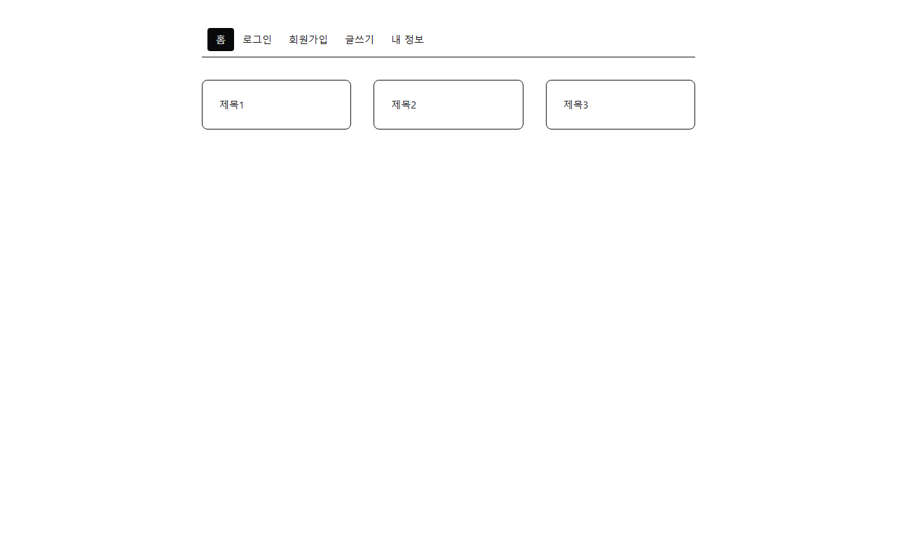

### 2. 글 상세 화면 그리고 카드에서 잇기

왜: 목록에서 글 하나로 들어가는 길이 있어야 상세를 볼 수 있다
실행하면: 카드 제목을 누르면 상세와 댓글 목록이 보인다

#### src/pages/Detail.jsx

```jsx
export default function Detail() {
  return (
    <div>
      <h1 className="text-2xl font-bold">제목1</h1>
      <p>작성자 ssar</p>
      <p className="my-8">내용1</p>
      <div className="flex gap-2">
        <button className="btn">수정</button>
        <button className="btn">삭제</button>
      </div>

      <hr className="my-8" />

      <h2 className="font-bold">댓글</h2>
      <ul className="list">
        <li className="list-row">
          <span>cos</span>
          <span>댓글1</span>
          <button className="btn btn-ghost btn-xs">🗑</button>
        </li>
        <li className="list-row">
          <span>love</span>
          <span>댓글2</span>
          <button className="btn btn-ghost btn-xs">🗑</button>
        </li>
      </ul>
      <form className="flex gap-2 mt-4">
        <input className="input flex-1" placeholder="댓글을 입력하세요" />
        <button className="btn">등록</button>
      </form>
    </div>
  );
}
```

#### src/pages/Home.jsx

```diff
@@ -1,14 +1,22 @@
+import { Link } from "react-router-dom";
+
 export default function Home() {
   return (
     <div className="grid grid-cols-3 gap-8">
       <div className="card border">
-        <div className="card-body">제목1</div>
+        <div className="card-body">
+          <Link to="/board/1">제목1</Link>
+        </div>
       </div>
       <div className="card border">
-        <div className="card-body">제목2</div>
+        <div className="card-body">
+          <Link to="/board/2">제목2</Link>
+        </div>
       </div>
       <div className="card border">
-        <div className="card-body">제목3</div>
+        <div className="card-body">
+          <Link to="/board/3">제목3</Link>
+        </div>
       </div>
     </div>
   );
```

#### src/App.jsx

```diff
@@ -1,6 +1,7 @@
 import { BrowserRouter, Routes, Route } from "react-router-dom";
 import Layout from "./components/Layout";
 import Home from "./pages/Home";
+import Detail from "./pages/Detail";
 
 export default function App() {
   return (
@@ -8,6 +9,7 @@ export default function App() {
       <Routes>
         <Route path="/" element={<Layout />}>
           <Route index element={<Home />} />
+          <Route path="board/:id" element={<Detail />} />
         </Route>
       </Routes>
     </BrowserRouter>
```


### 3. 글쓰기 화면 그리기

왜: 폼 화면의 틀을 하나 정하면 나머지 폼이 같은 틀을 따른다
실행하면: 글쓰기 메뉴를 누르면 글쓰기 폼이 보인다

#### src/pages/SaveForm.jsx

```jsx
export default function SaveForm() {
  return (
    <form className="card border max-w-sm mx-auto p-8 gap-4">
      <h1 className="text-2xl font-bold">글쓰기</h1>
      <input className="input" placeholder="제목" />
      <textarea className="textarea" placeholder="내용" />
      <button className="btn">글쓰기</button>
    </form>
  );
}
```

#### src/App.jsx

```diff
@@ -2,6 +2,7 @@ import { BrowserRouter, Routes, Route } from "react-router-dom";
 import Layout from "./components/Layout";
 import Home from "./pages/Home";
 import Detail from "./pages/Detail";
+import SaveForm from "./pages/SaveForm";
 
 export default function App() {
   return (
@@ -10,6 +11,7 @@ export default function App() {
         <Route path="/" element={<Layout />}>
           <Route index element={<Home />} />
           <Route path="board/:id" element={<Detail />} />
+          <Route path="save-form" element={<SaveForm />} />
         </Route>
       </Routes>
     </BrowserRouter>
```

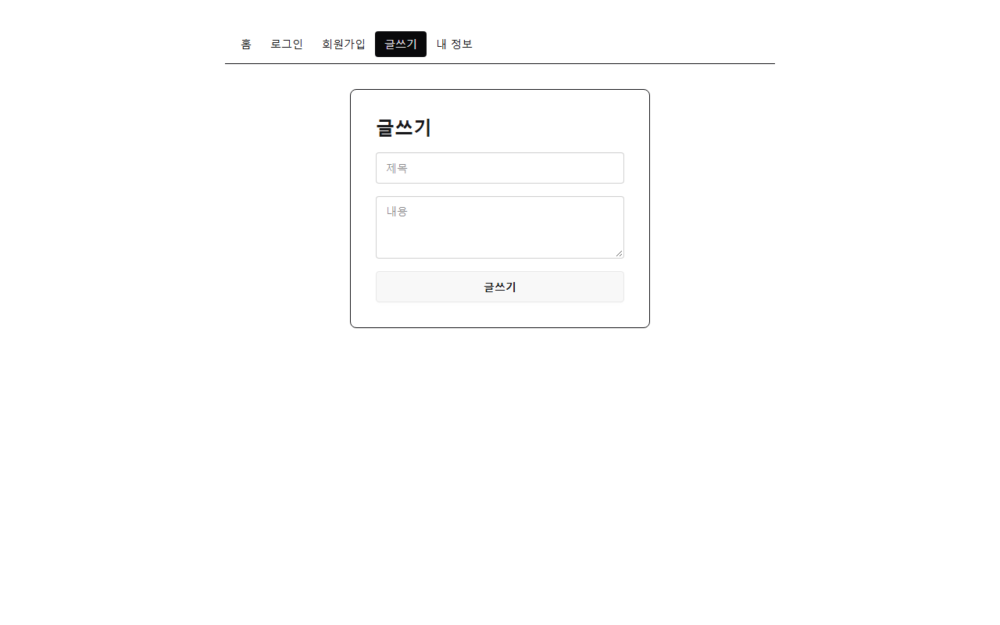

### 4. 수정 화면 그리고 상세에서 잇기

왜: 수정 화면은 메뉴가 없어서 상세에서 들어가는 길이 필요하다
실행하면: 상세의 수정을 누르면 글 수정 폼이 보인다

#### src/pages/Detail.jsx

```diff
@@ -1,3 +1,5 @@
+import { Link } from "react-router-dom";
+
 export default function Detail() {
   return (
     <div>
@@ -5,7 +7,9 @@ export default function Detail() {
       <p>작성자 ssar</p>
       <p className="my-8">내용1</p>
       <div className="flex gap-2">
-        <button className="btn">수정</button>
+        <Link to="/update-form/1" className="btn">
+          수정
+        </Link>
         <button className="btn">삭제</button>
       </div>
 
```

#### src/pages/UpdateForm.jsx

```jsx
export default function UpdateForm() {
  return (
    <form className="card border max-w-sm mx-auto p-8 gap-4">
      <h1 className="text-2xl font-bold">글 수정</h1>
      <input className="input" placeholder="제목" />
      <textarea className="textarea" placeholder="내용" />
      <button className="btn">수정하기</button>
    </form>
  );
}
```

#### src/App.jsx

```diff
@@ -3,6 +3,7 @@ import Layout from "./components/Layout";
 import Home from "./pages/Home";
 import Detail from "./pages/Detail";
 import SaveForm from "./pages/SaveForm";
+import UpdateForm from "./pages/UpdateForm";
 
 export default function App() {
   return (
@@ -12,6 +13,7 @@ export default function App() {
           <Route index element={<Home />} />
           <Route path="board/:id" element={<Detail />} />
           <Route path="save-form" element={<SaveForm />} />
+          <Route path="update-form/:id" element={<UpdateForm />} />
         </Route>
       </Routes>
     </BrowserRouter>
```


### 5. 로그인 화면 그리기

왜: 로그인 장에서 이 폼에 동작을 붙인다
실행하면: 로그인 메뉴를 누르면 로그인 폼이 보인다

#### src/pages/LoginForm.jsx

```jsx
export default function LoginForm() {
  return (
    <form className="card border max-w-sm mx-auto p-8 gap-4">
      <h1 className="text-2xl font-bold">로그인</h1>
      <input className="input" placeholder="아이디" />
      <input className="input" type="password" placeholder="비밀번호" />
      <button className="btn">로그인</button>
    </form>
  );
}
```

#### src/App.jsx

```diff
@@ -4,6 +4,7 @@ import Home from "./pages/Home";
 import Detail from "./pages/Detail";
 import SaveForm from "./pages/SaveForm";
 import UpdateForm from "./pages/UpdateForm";
+import LoginForm from "./pages/LoginForm";
 
 export default function App() {
   return (
@@ -14,6 +15,7 @@ export default function App() {
           <Route path="board/:id" element={<Detail />} />
           <Route path="save-form" element={<SaveForm />} />
           <Route path="update-form/:id" element={<UpdateForm />} />
+          <Route path="login-form" element={<LoginForm />} />
         </Route>
       </Routes>
     </BrowserRouter>
```

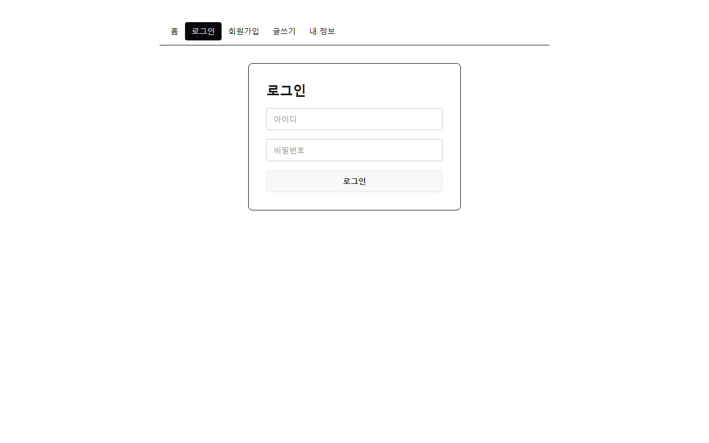

### 6. 회원가입 화면 그리기

왜: 회원가입 장에서 이 폼에 동작을 붙인다
실행하면: 회원가입 메뉴를 누르면 회원가입 폼이 보인다

#### src/pages/JoinForm.jsx

```jsx
export default function JoinForm() {
  return (
    <form className="card border max-w-sm mx-auto p-8 gap-4">
      <h1 className="text-2xl font-bold">회원가입</h1>
      <input className="input" placeholder="아이디" />
      <input className="input" type="password" placeholder="비밀번호" />
      <input className="input" placeholder="이메일" />
      <button className="btn">가입하기</button>
    </form>
  );
}
```

#### src/App.jsx

```diff
@@ -5,6 +5,7 @@ import Detail from "./pages/Detail";
 import SaveForm from "./pages/SaveForm";
 import UpdateForm from "./pages/UpdateForm";
 import LoginForm from "./pages/LoginForm";
+import JoinForm from "./pages/JoinForm";
 
 export default function App() {
   return (
@@ -16,6 +17,7 @@ export default function App() {
           <Route path="save-form" element={<SaveForm />} />
           <Route path="update-form/:id" element={<UpdateForm />} />
           <Route path="login-form" element={<LoginForm />} />
+          <Route path="join-form" element={<JoinForm />} />
         </Route>
       </Routes>
     </BrowserRouter>
```

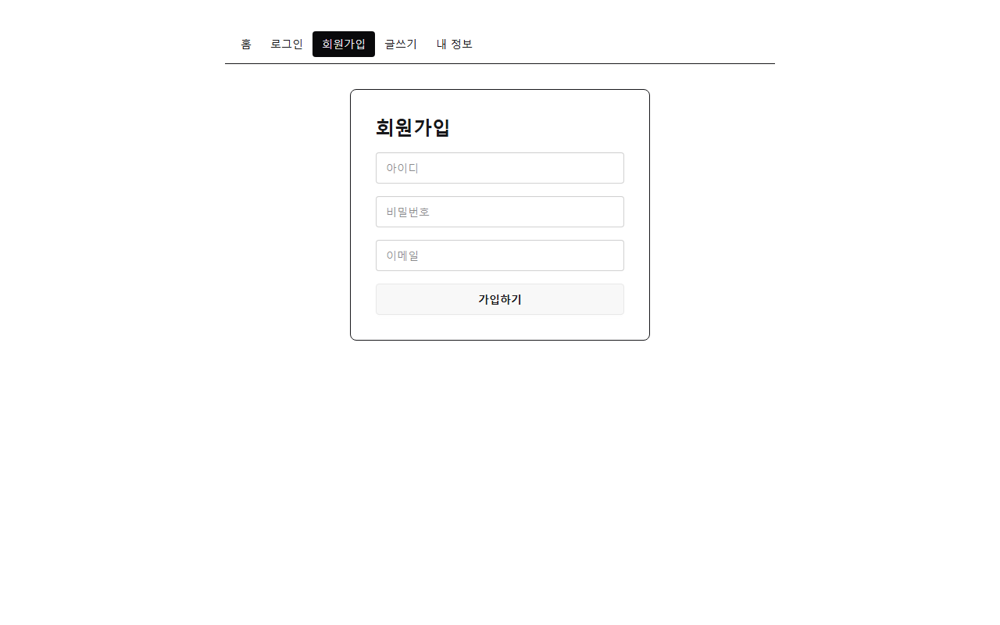

### 7. 내 정보 화면 그리기

왜: 마지막 메뉴 화면이 생겨 헤더의 모든 메뉴가 화면을 갖는다
실행하면: 내 정보 메뉴를 누르면 아이디가 채워진 폼이 보인다. 메뉴 5개가 모두 화면으로 간다

#### src/pages/UserInfo.jsx

```jsx
export default function UserInfo() {
  return (
    <form className="card border max-w-sm mx-auto p-8 gap-4">
      <h1 className="text-2xl font-bold">내 정보</h1>
      <input className="input" value="ssar" readOnly />
      <input className="input" placeholder="이메일" />
      <input className="input" type="password" placeholder="새 비밀번호" />
      <button className="btn">수정하기</button>
    </form>
  );
}
```

#### src/App.jsx

```diff
@@ -6,6 +6,7 @@ import SaveForm from "./pages/SaveForm";
 import UpdateForm from "./pages/UpdateForm";
 import LoginForm from "./pages/LoginForm";
 import JoinForm from "./pages/JoinForm";
+import UserInfo from "./pages/UserInfo";
 
 export default function App() {
   return (
@@ -18,6 +19,7 @@ export default function App() {
           <Route path="update-form/:id" element={<UpdateForm />} />
           <Route path="login-form" element={<LoginForm />} />
           <Route path="join-form" element={<JoinForm />} />
+          <Route path="user-info" element={<UserInfo />} />
         </Route>
       </Routes>
     </BrowserRouter>
```


## 4 component-split 겹치는 화면을 컴포넌트로

### 1. 글 카드를 컴포넌트로 빼고 props로 넘기기

왜: 같은 카드 마크업을 한 곳에 두고 다른 값만 props로 넘기면 고칠 곳이 하나가 된다
실행하면: 홈 카드 3개가 그대로 보인다. Home은 BoardCard를 세 번 쓴다

#### src/components/BoardCard.jsx

```jsx
import { Link } from "react-router-dom";

export default function BoardCard({ id, title }) {
  return (
    <div className="card border">
      <div className="card-body">
        <Link to={`/board/${id}`}>{title}</Link>
      </div>
    </div>
  );
}
```

#### src/pages/Home.jsx

```diff
@@ -1,23 +1,11 @@
-import { Link } from "react-router-dom";
+import BoardCard from "../components/BoardCard";
 
 export default function Home() {
   return (
     <div className="grid grid-cols-3 gap-8">
-      <div className="card border">
-        <div className="card-body">
-          <Link to="/board/1">제목1</Link>
-        </div>
-      </div>
-      <div className="card border">
-        <div className="card-body">
-          <Link to="/board/2">제목2</Link>
-        </div>
-      </div>
-      <div className="card border">
-        <div className="card-body">
-          <Link to="/board/3">제목3</Link>
-        </div>
-      </div>
+      <BoardCard id={1} title="제목1" />
+      <BoardCard id={2} title="제목2" />
+      <BoardCard id={3} title="제목3" />
     </div>
   );
 }
```


### 2. 글 배열을 map으로 그리기

왜: 글이 몇 개든 배열만 바꾸면 카드가 그려진다
실행하면: 홈 카드 3개가 그대로 보인다. BoardCard는 한 번만 쓴다

#### src/pages/Home.jsx

```diff
@@ -1,11 +1,17 @@
 import BoardCard from "../components/BoardCard";
 
 export default function Home() {
+  const boards = [
+    { id: 1, title: "제목1" },
+    { id: 2, title: "제목2" },
+    { id: 3, title: "제목3" },
+  ];
+
   return (
     <div className="grid grid-cols-3 gap-8">
-      <BoardCard id={1} title="제목1" />
-      <BoardCard id={2} title="제목2" />
-      <BoardCard id={3} title="제목3" />
+      {boards.map((board) => (
+        <BoardCard key={board.id} id={board.id} title={board.title} />
+      ))}
     </div>
   );
 }
```


### 3. 댓글 줄을 컴포넌트로 빼고 map으로 그리기

왜: 글 카드에서 배운 조각과 map을 댓글에도 똑같이 쓴다
실행하면: 상세 댓글 2줄이 그대로 보인다

#### src/components/ReplyItem.jsx

```jsx
export default function ReplyItem({ username, comment }) {
  return (
    <li className="list-row">
      <span>{username}</span>
      <span>{comment}</span>
      <button className="btn btn-ghost btn-xs">🗑</button>
    </li>
  );
}
```

#### src/pages/Detail.jsx

```diff
@@ -1,6 +1,12 @@
 import { Link } from "react-router-dom";
+import ReplyItem from "../components/ReplyItem";
 
 export default function Detail() {
+  const replies = [
+    { id: 1, username: "cos", comment: "댓글1" },
+    { id: 2, username: "love", comment: "댓글2" },
+  ];
+
   return (
     <div>
       <h1 className="text-2xl font-bold">제목1</h1>
@@ -17,16 +23,13 @@ export default function Detail() {
 
       <h2 className="font-bold">댓글</h2>
       <ul className="list">
-        <li className="list-row">
-          <span>cos</span>
-          <span>댓글1</span>
-          <button className="btn btn-ghost btn-xs">🗑</button>
-        </li>
-        <li className="list-row">
-          <span>love</span>
-          <span>댓글2</span>
-          <button className="btn btn-ghost btn-xs">🗑</button>
-        </li>
+        {replies.map((reply) => (
+          <ReplyItem
+            key={reply.id}
+            username={reply.username}
+            comment={reply.comment}
+          />
+        ))}
       </ul>
       <form className="flex gap-2 mt-4">
         <input className="input flex-1" placeholder="댓글을 입력하세요" />
```

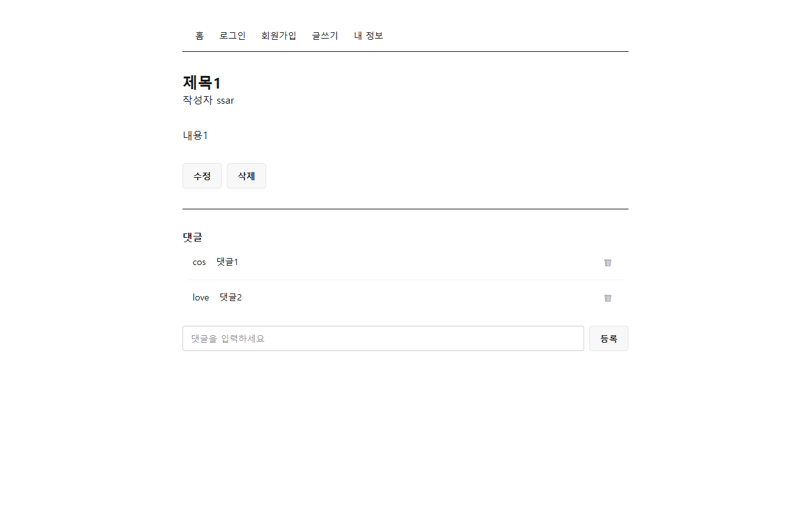

### 4. 폼 틀을 컴포넌트로 빼고 children으로 넘기기

왜: 틀은 같고 안의 입력칸만 다르니 안쪽 마크업을 children으로 넘긴다
실행하면: 폼 5개가 그대로 보인다. 다섯 화면 모두 FormCard를 쓴다

#### src/components/FormCard.jsx

```jsx
export default function FormCard({ title, children }) {
  return (
    <form className="card border max-w-sm mx-auto p-8 gap-4">
      <h1 className="text-2xl font-bold">{title}</h1>
      {children}
    </form>
  );
}
```

#### src/pages/JoinForm.jsx

```diff
@@ -1,11 +1,12 @@
+import FormCard from "../components/FormCard";
+
 export default function JoinForm() {
   return (
-    <form className="card border max-w-sm mx-auto p-8 gap-4">
-      <h1 className="text-2xl font-bold">회원가입</h1>
+    <FormCard title="회원가입">
       <input className="input" placeholder="아이디" />
       <input className="input" type="password" placeholder="비밀번호" />
       <input className="input" placeholder="이메일" />
       <button className="btn">가입하기</button>
-    </form>
+    </FormCard>
   );
 }
```

#### src/pages/LoginForm.jsx

```diff
@@ -1,10 +1,11 @@
+import FormCard from "../components/FormCard";
+
 export default function LoginForm() {
   return (
-    <form className="card border max-w-sm mx-auto p-8 gap-4">
-      <h1 className="text-2xl font-bold">로그인</h1>
+    <FormCard title="로그인">
       <input className="input" placeholder="아이디" />
       <input className="input" type="password" placeholder="비밀번호" />
       <button className="btn">로그인</button>
-    </form>
+    </FormCard>
   );
 }
```

#### src/pages/SaveForm.jsx

```diff
@@ -1,10 +1,11 @@
+import FormCard from "../components/FormCard";
+
 export default function SaveForm() {
   return (
-    <form className="card border max-w-sm mx-auto p-8 gap-4">
-      <h1 className="text-2xl font-bold">글쓰기</h1>
+    <FormCard title="글쓰기">
       <input className="input" placeholder="제목" />
       <textarea className="textarea" placeholder="내용" />
       <button className="btn">글쓰기</button>
-    </form>
+    </FormCard>
   );
 }
```

#### src/pages/UpdateForm.jsx

```diff
@@ -1,10 +1,11 @@
+import FormCard from "../components/FormCard";
+
 export default function UpdateForm() {
   return (
-    <form className="card border max-w-sm mx-auto p-8 gap-4">
-      <h1 className="text-2xl font-bold">글 수정</h1>
+    <FormCard title="글 수정">
       <input className="input" placeholder="제목" />
       <textarea className="textarea" placeholder="내용" />
       <button className="btn">수정하기</button>
-    </form>
+    </FormCard>
   );
 }
```

#### src/pages/UserInfo.jsx

```diff
@@ -1,11 +1,12 @@
+import FormCard from "../components/FormCard";
+
 export default function UserInfo() {
   return (
-    <form className="card border max-w-sm mx-auto p-8 gap-4">
-      <h1 className="text-2xl font-bold">내 정보</h1>
+    <FormCard title="내 정보">
       <input className="input" value="ssar" readOnly />
       <input className="input" placeholder="이메일" />
       <input className="input" type="password" placeholder="새 비밀번호" />
       <button className="btn">수정하기</button>
-    </form>
+    </FormCard>
   );
 }
```


### 5. 입력칸을 컴포넌트로 빼고 props 펼치기

왜: 입력칸마다 넘기는 속성이 달라 props를 하나씩 꺼내지 않고 통째로 펼쳐 넘긴다
실행하면: 입력칸 모습, 비밀번호 가림, 아이디 읽기만이 그대로다

#### src/components/Input.jsx

```jsx
export default function Input(props) {
  return <input className="input" {...props} />;
}
```

#### src/pages/JoinForm.jsx

```diff
@@ -1,11 +1,12 @@
 import FormCard from "../components/FormCard";
+import Input from "../components/Input";
 
 export default function JoinForm() {
   return (
     <FormCard title="회원가입">
-      <input className="input" placeholder="아이디" />
-      <input className="input" type="password" placeholder="비밀번호" />
-      <input className="input" placeholder="이메일" />
+      <Input placeholder="아이디" />
+      <Input type="password" placeholder="비밀번호" />
+      <Input placeholder="이메일" />
       <button className="btn">가입하기</button>
     </FormCard>
   );
```

#### src/pages/LoginForm.jsx

```diff
@@ -1,10 +1,11 @@
 import FormCard from "../components/FormCard";
+import Input from "../components/Input";
 
 export default function LoginForm() {
   return (
     <FormCard title="로그인">
-      <input className="input" placeholder="아이디" />
-      <input className="input" type="password" placeholder="비밀번호" />
+      <Input placeholder="아이디" />
+      <Input type="password" placeholder="비밀번호" />
       <button className="btn">로그인</button>
     </FormCard>
   );
```

#### src/pages/SaveForm.jsx

```diff
@@ -1,9 +1,10 @@
 import FormCard from "../components/FormCard";
+import Input from "../components/Input";
 
 export default function SaveForm() {
   return (
     <FormCard title="글쓰기">
-      <input className="input" placeholder="제목" />
+      <Input placeholder="제목" />
       <textarea className="textarea" placeholder="내용" />
       <button className="btn">글쓰기</button>
     </FormCard>
```

#### src/pages/UpdateForm.jsx

```diff
@@ -1,9 +1,10 @@
 import FormCard from "../components/FormCard";
+import Input from "../components/Input";
 
 export default function UpdateForm() {
   return (
     <FormCard title="글 수정">
-      <input className="input" placeholder="제목" />
+      <Input placeholder="제목" />
       <textarea className="textarea" placeholder="내용" />
       <button className="btn">수정하기</button>
     </FormCard>
```

#### src/pages/UserInfo.jsx

```diff
@@ -1,11 +1,12 @@
 import FormCard from "../components/FormCard";
+import Input from "../components/Input";
 
 export default function UserInfo() {
   return (
     <FormCard title="내 정보">
-      <input className="input" value="ssar" readOnly />
-      <input className="input" placeholder="이메일" />
-      <input className="input" type="password" placeholder="새 비밀번호" />
+      <Input value="ssar" readOnly />
+      <Input placeholder="이메일" />
+      <Input type="password" placeholder="새 비밀번호" />
       <button className="btn">수정하기</button>
     </FormCard>
   );
```


## 5 board-list 글 목록

그림완성.md로 합류했다면 여기부터 친다.

### 1. 글 목록을 state로 바꾸고 빈 목록에서 시작하기

왜: 서버 응답은 늦게 오므로 화면은 빈 목록으로 먼저 그려지고 state가 바뀌면 다시 그려진다
실행하면: 홈에 카드가 하나도 없다

#### src/pages/Home.jsx

```diff
@@ -1,11 +1,8 @@
+import { useState } from "react";
 import BoardCard from "../components/BoardCard";
 
 export default function Home() {
-  const boards = [
-    { id: 1, title: "제목1" },
-    { id: 2, title: "제목2" },
-    { id: 3, title: "제목3" },
-  ];
+  const [boards, setBoards] = useState([]);
 
   return (
     <div className="grid grid-cols-3 gap-8">
```

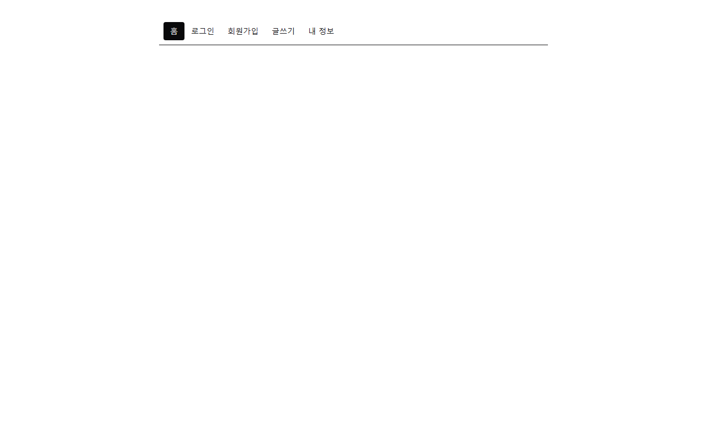

### 2. useEffect에서 서버 글 목록 받아 그리기

왜: 화면이 그려진 뒤 한 번 서버에 물어 받은 글로 state를 채운다
실행하면: 제목4, 제목3, 제목2 카드가 보이고 제목4를 누르면 /board/4로 간다

#### src/pages/Home.jsx

```diff
@@ -1,9 +1,18 @@
-import { useState } from "react";
+import { useEffect, useState } from "react";
+import axios from "axios";
 import BoardCard from "../components/BoardCard";
 
 export default function Home() {
   const [boards, setBoards] = useState([]);
 
+  useEffect(() => {
+    async function loadBoards() {
+      const res = await axios.get("http://localhost:8080/?page=0");
+      setBoards(res.data.body.boards);
+    }
+    loadBoards();
+  }, []);
+
   return (
     <div className="grid grid-cols-3 gap-8">
       {boards.map((board) => (
```


## 6 board-detail 글 상세

### 1. 주소에서 글 번호를 꺼내 수정 링크에 쓰기

왜: 주소의 글 번호를 꺼낼 수 있어야 그 번호로 서버에 글을 물을 수 있다
실행하면: /board/4에서 수정을 누르면 /update-form/4로 간다. 나머지는 아직 예시 글자다

#### src/pages/Detail.jsx

```diff
@@ -1,7 +1,9 @@
-import { Link } from "react-router-dom";
+import { Link, useParams } from "react-router-dom";
 import ReplyItem from "../components/ReplyItem";
 
 export default function Detail() {
+  const { id } = useParams();
+
   const replies = [
     { id: 1, username: "cos", comment: "댓글1" },
     { id: 2, username: "love", comment: "댓글2" },
@@ -13,7 +15,7 @@ export default function Detail() {
       <p>작성자 ssar</p>
       <p className="my-8">내용1</p>
       <div className="flex gap-2">
-        <Link to="/update-form/1" className="btn">
+        <Link to={`/update-form/${id}`} className="btn">
           수정
         </Link>
         <button className="btn">삭제</button>
```


### 2. 글을 state로 바꾸고 빈 상세에서 시작하기

왜: 서버 응답은 늦게 오므로 화면은 빈 글로 먼저 그려지고 state가 바뀌면 다시 그려진다
실행하면: 상세에 제목, 내용, 댓글이 비어 있다

#### src/pages/Detail.jsx

```diff
@@ -1,19 +1,21 @@
+import { useState } from "react";
 import { Link, useParams } from "react-router-dom";
 import ReplyItem from "../components/ReplyItem";
 
 export default function Detail() {
   const { id } = useParams();
-
-  const replies = [
-    { id: 1, username: "cos", comment: "댓글1" },
-    { id: 2, username: "love", comment: "댓글2" },
-  ];
+  const [board, setBoard] = useState({
+    title: "",
+    content: "",
+    username: "",
+    replies: [],
+  });
 
   return (
     <div>
-      <h1 className="text-2xl font-bold">제목1</h1>
-      <p>작성자 ssar</p>
-      <p className="my-8">내용1</p>
+      <h1 className="text-2xl font-bold">{board.title}</h1>
+      <p>작성자 {board.username}</p>
+      <p className="my-8">{board.content}</p>
       <div className="flex gap-2">
         <Link to={`/update-form/${id}`} className="btn">
           수정
@@ -25,7 +27,7 @@ export default function Detail() {
 
       <h2 className="font-bold">댓글</h2>
       <ul className="list">
-        {replies.map((reply) => (
+        {board.replies.map((reply) => (
           <ReplyItem
             key={reply.id}
             username={reply.username}
```

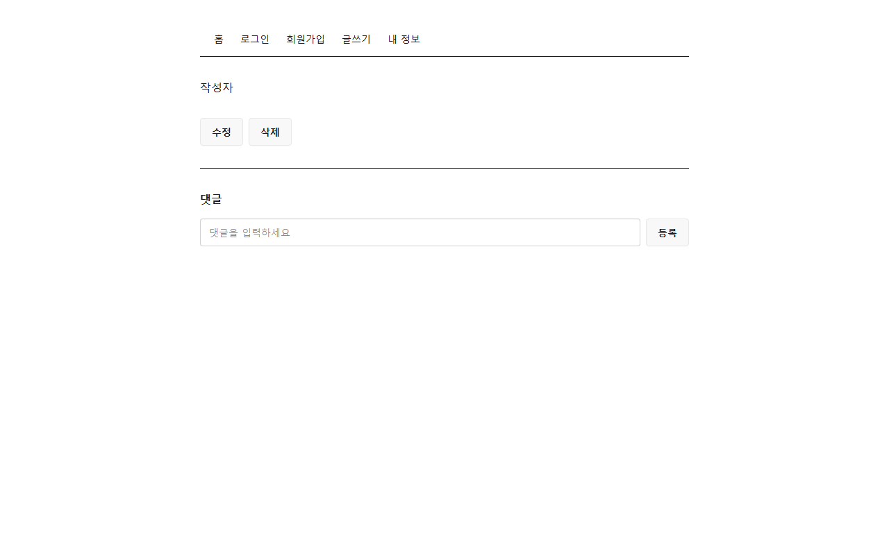

### 3. useEffect에서 서버 상세 받아 그리기

왜: 화면이 그려진 뒤 주소의 글 번호로 서버에 물어 받은 글로 state를 채운다
실행하면: /board/4에 제목4, 작성자 love, 내용4와 댓글 ssar 댓글1, ssar 댓글2, cos 댓글3이 보인다

#### src/pages/Detail.jsx

```diff
@@ -1,4 +1,5 @@
-import { useState } from "react";
+import { useEffect, useState } from "react";
+import axios from "axios";
 import { Link, useParams } from "react-router-dom";
 import ReplyItem from "../components/ReplyItem";
 
@@ -11,6 +12,14 @@ export default function Detail() {
     replies: [],
   });
 
+  useEffect(() => {
+    async function loadBoard() {
+      const res = await axios.get(`http://localhost:8080/api/boards/${id}`);
+      setBoard(res.data.body);
+    }
+    loadBoard();
+  }, [id]);
+
   return (
     <div>
       <h1 className="text-2xl font-bold">{board.title}</h1>
```


## 7 join 회원가입

### 1. 입력값을 객체로 기억하기

왜: 입력한 값을 서버로 보내려면 화면이 기억하고 있어야 한다
실행하면: 세 칸에 친 글자가 그대로 보이고, React 개발자 도구에서 state 세 개가 바뀐다

#### src/pages/JoinForm.jsx

```diff
@@ -1,12 +1,35 @@
+import { useState } from "react";
 import FormCard from "../components/FormCard";
 import Input from "../components/Input";
 
 export default function JoinForm() {
+  const [form, setForm] = useState({ username: "", password: "", email: "" });
+
+  function handleChange(e) {
+    setForm({ ...form, [e.target.name]: e.target.value });
+  }
+
   return (
     <FormCard title="회원가입">
-      <Input placeholder="아이디" />
-      <Input type="password" placeholder="비밀번호" />
-      <Input placeholder="이메일" />
+      <Input
+        name="username"
+        placeholder="아이디"
+        value={form.username}
+        onChange={handleChange}
+      />
+      <Input
+        name="password"
+        type="password"
+        placeholder="비밀번호"
+        value={form.password}
+        onChange={handleChange}
+      />
+      <Input
+        name="email"
+        placeholder="이메일"
+        value={form.email}
+        onChange={handleChange}
+      />
       <button className="btn">가입하기</button>
     </FormCard>
   );
```

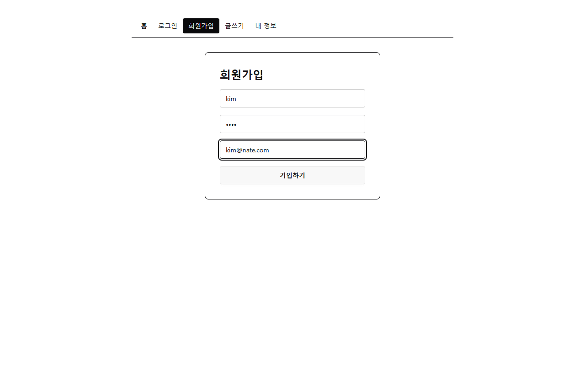

### 2. 가입하기를 누르면 서버에 보내기

왜: 제출을 막고 기억한 값을 서버에 보내야 사용자가 저장된다
실행하면: 새로고침 없이 네트워크 탭에 POST /join이 보이고 응답이 성공이다

#### src/components/FormCard.jsx

```diff
@@ -1,6 +1,9 @@
-export default function FormCard({ title, children }) {
+export default function FormCard({ title, onSubmit, children }) {
   return (
-    <form className="card border max-w-sm mx-auto p-8 gap-4">
+    <form
+      onSubmit={onSubmit}
+      className="card border max-w-sm mx-auto p-8 gap-4"
+    >
       <h1 className="text-2xl font-bold">{title}</h1>
       {children}
     </form>
```

#### src/pages/JoinForm.jsx

```diff
@@ -1,4 +1,5 @@
 import { useState } from "react";
+import axios from "axios";
 import FormCard from "../components/FormCard";
 import Input from "../components/Input";
 
@@ -9,8 +10,13 @@ export default function JoinForm() {
     setForm({ ...form, [e.target.name]: e.target.value });
   }
 
+  async function handleSubmit(e) {
+    e.preventDefault();
+    await axios.post("http://localhost:8080/join", form);
+  }
+
   return (
-    <FormCard title="회원가입">
+    <FormCard title="회원가입" onSubmit={handleSubmit}>
       <Input
         name="username"
         placeholder="아이디"
```

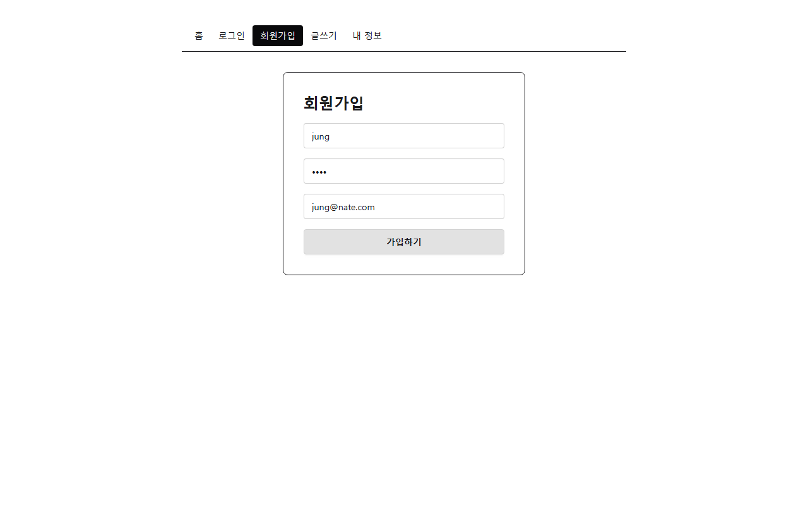

### 3. 가입에 성공하면 안내를 띄우고 로그인 화면으로 가기

왜: 가입이 끝났음을 알리고 바로 로그인할 수 있게 한다
실행하면: 회원가입 완료 안내가 뜨고, 확인을 누르면 로그인 화면으로 간다

#### src/pages/JoinForm.jsx

```diff
@@ -1,10 +1,12 @@
 import { useState } from "react";
 import axios from "axios";
+import { useNavigate } from "react-router-dom";
 import FormCard from "../components/FormCard";
 import Input from "../components/Input";
 
 export default function JoinForm() {
   const [form, setForm] = useState({ username: "", password: "", email: "" });
+  const navigate = useNavigate();
 
   function handleChange(e) {
     setForm({ ...form, [e.target.name]: e.target.value });
@@ -13,6 +15,8 @@ export default function JoinForm() {
   async function handleSubmit(e) {
     e.preventDefault();
     await axios.post("http://localhost:8080/join", form);
+    alert("회원가입 완료");
+    navigate("/login-form");
   }
 
   return (
```


## 8 login 로그인

### 1. 로그인 입력값을 객체로 기억하기

왜: 입력한 아이디와 비밀번호를 서버로 보내려면 화면이 기억하고 있어야 한다
실행하면: 두 칸에 친 글자가 그대로 보인다

#### src/pages/LoginForm.jsx

```diff
@@ -1,11 +1,29 @@
+import { useState } from "react";
 import FormCard from "../components/FormCard";
 import Input from "../components/Input";
 
 export default function LoginForm() {
+  const [form, setForm] = useState({ username: "", password: "" });
+
+  function handleChange(e) {
+    setForm({ ...form, [e.target.name]: e.target.value });
+  }
+
   return (
     <FormCard title="로그인">
-      <Input placeholder="아이디" />
-      <Input type="password" placeholder="비밀번호" />
+      <Input
+        name="username"
+        placeholder="아이디"
+        value={form.username}
+        onChange={handleChange}
+      />
+      <Input
+        name="password"
+        type="password"
+        placeholder="비밀번호"
+        value={form.password}
+        onChange={handleChange}
+      />
       <button className="btn">로그인</button>
     </FormCard>
   );
```

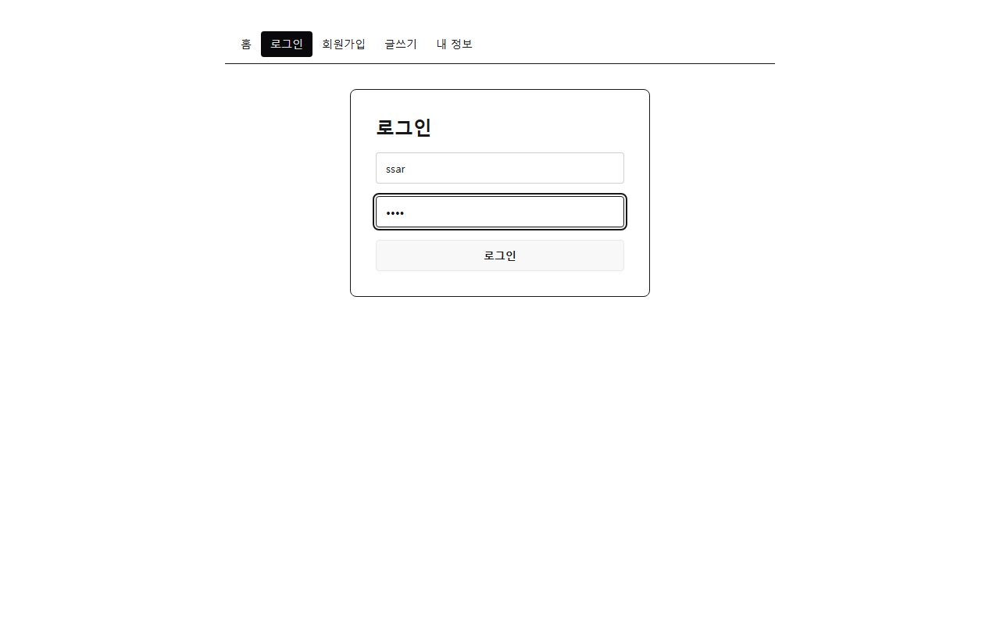

### 2. 로그인을 누르면 서버에 보내기

왜: 서버가 아이디와 비밀번호를 확인해야 토큰을 받을 수 있다
실행하면: 새로고침 없이 네트워크 탭에 POST /login이 보이고, 응답 헤더에 Authorization: Bearer ...가 있다

#### src/pages/LoginForm.jsx

```diff
@@ -1,4 +1,5 @@
 import { useState } from "react";
+import axios from "axios";
 import FormCard from "../components/FormCard";
 import Input from "../components/Input";
 
@@ -9,8 +10,13 @@ export default function LoginForm() {
     setForm({ ...form, [e.target.name]: e.target.value });
   }
 
+  async function handleSubmit(e) {
+    e.preventDefault();
+    await axios.post("http://localhost:8080/login", form);
+  }
+
   return (
-    <FormCard title="로그인">
+    <FormCard title="로그인" onSubmit={handleSubmit}>
       <Input
         name="username"
         placeholder="아이디"
```

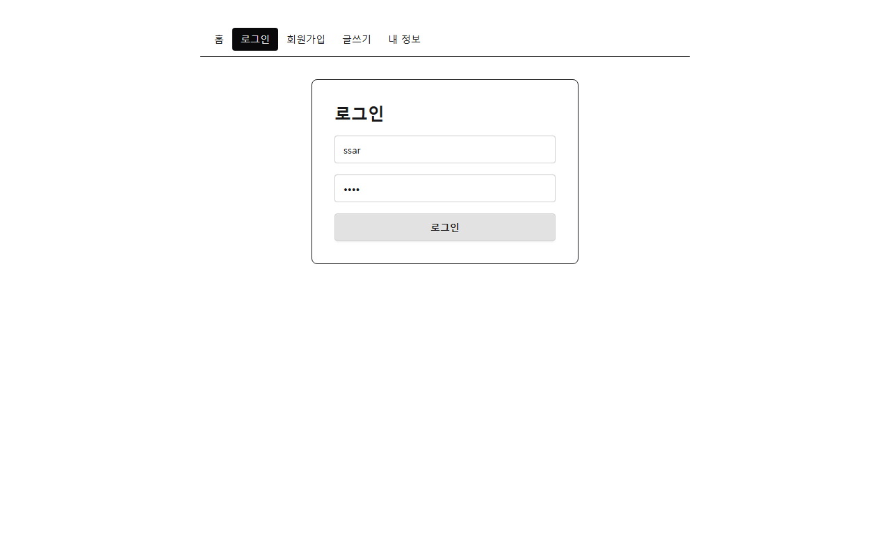

### 3. 로그인 상태를 스토어에 기억하고 홈으로 가기

왜: 받은 토큰과 아이디를 여러 화면이 함께 보려면 컴포넌트 밖 스토어에 두어야 한다
실행하면: ssar, 1234로 로그인하면 홈으로 간다. 헤더 메뉴는 아직 그대로다

#### src/pages/LoginForm.jsx

```diff
@@ -1,10 +1,14 @@
 import { useState } from "react";
 import axios from "axios";
+import { useNavigate } from "react-router-dom";
 import FormCard from "../components/FormCard";
 import Input from "../components/Input";
+import { useAuthStore } from "../store/authStore";
 
 export default function LoginForm() {
   const [form, setForm] = useState({ username: "", password: "" });
+  const login = useAuthStore((state) => state.login);
+  const navigate = useNavigate();
 
   function handleChange(e) {
     setForm({ ...form, [e.target.name]: e.target.value });
@@ -12,7 +16,10 @@ export default function LoginForm() {
 
   async function handleSubmit(e) {
     e.preventDefault();
-    await axios.post("http://localhost:8080/login", form);
+    const res = await axios.post("http://localhost:8080/login", form);
+    const jwt = res.headers.authorization;
+    login(jwt, form.username);
+    navigate("/");
   }
 
   return (
```

#### src/store/authStore.jsx

```jsx
import { create } from "zustand";

export const useAuthStore = create((set) => ({
  isLogin: false,
  jwt: "",
  username: "",
  login: (jwt, username) => set({ isLogin: true, jwt, username }),
}));
```


### 4. 로그인 여부로 헤더 메뉴 바꾸기

왜: 로그인했는지에 따라 쓸 수 있는 메뉴가 다르다
실행하면: 로그인 전에는 홈, 로그인, 회원가입이 보인다. 로그인 뒤에는 홈, 글쓰기, 내 정보, 로그아웃, ssar님이 보인다

#### src/components/Header.jsx

```diff
@@ -1,6 +1,10 @@
 import { NavLink } from "react-router-dom";
+import { useAuthStore } from "../store/authStore";
 
 export default function Header() {
+  const isLogin = useAuthStore((state) => state.isLogin);
+  const username = useAuthStore((state) => state.username);
+
   return (
     <ul className="menu menu-horizontal">
       <li>
@@ -8,18 +12,31 @@ export default function Header() {
           홈
         </NavLink>
       </li>
-      <li>
-        <NavLink to="/login-form">로그인</NavLink>
-      </li>
-      <li>
-        <NavLink to="/join-form">회원가입</NavLink>
-      </li>
-      <li>
-        <NavLink to="/save-form">글쓰기</NavLink>
-      </li>
-      <li>
-        <NavLink to="/user-info">내 정보</NavLink>
-      </li>
+      {isLogin ? (
+        <>
+          <li>
+            <NavLink to="/save-form">글쓰기</NavLink>
+          </li>
+          <li>
+            <NavLink to="/user-info">내 정보</NavLink>
+          </li>
+          <li>
+            <button>로그아웃</button>
+          </li>
+          <li>
+            <span>{username}님</span>
+          </li>
+        </>
+      ) : (
+        <>
+          <li>
+            <NavLink to="/login-form">로그인</NavLink>
+          </li>
+          <li>
+            <NavLink to="/join-form">회원가입</NavLink>
+          </li>
+        </>
+      )}
     </ul>
   );
 }
```


### 5. 로그아웃하면 로그인 상태 비우기

왜: 기억한 토큰과 아이디를 지워야 다른 사람이 이어서 쓰지 못한다
실행하면: 로그아웃을 누르면 홈으로 가고 헤더가 로그인 전 메뉴로 돌아간다

#### src/components/Header.jsx

```diff
@@ -1,9 +1,16 @@
-import { NavLink } from "react-router-dom";
+import { NavLink, useNavigate } from "react-router-dom";
 import { useAuthStore } from "../store/authStore";
 
 export default function Header() {
   const isLogin = useAuthStore((state) => state.isLogin);
   const username = useAuthStore((state) => state.username);
+  const logout = useAuthStore((state) => state.logout);
+  const navigate = useNavigate();
+
+  function handleLogout() {
+    logout();
+    navigate("/");
+  }
 
   return (
     <ul className="menu menu-horizontal">
@@ -21,7 +28,7 @@ export default function Header() {
             <NavLink to="/user-info">내 정보</NavLink>
           </li>
           <li>
-            <button>로그아웃</button>
+            <button onClick={handleLogout}>로그아웃</button>
           </li>
           <li>
             <span>{username}님</span>
```

#### src/store/authStore.jsx

```diff
@@ -5,4 +5,5 @@ export const useAuthStore = create((set) => ({
   jwt: "",
   username: "",
   login: (jwt, username) => set({ isLogin: true, jwt, username }),
+  logout: () => set({ isLogin: false, jwt: "", username: "" }),
 }));
```


## 9 login-keep 로그인 유지

### 1. 로그인하면 토큰을 브라우저에 저장하기

왜: 새로고침해도 남는 곳에 토큰이 있어야 다음 단계에서 되살릴 수 있다
실행하면: ssar로 로그인한 뒤 개발자 도구 Application 탭의 Local Storage에 jwt가 보인다. 새로고침하면 아직 로그인 전 메뉴로 돌아간다

#### src/store/authStore.jsx

```diff
@@ -4,6 +4,9 @@ export const useAuthStore = create((set) => ({
   isLogin: false,
   jwt: "",
   username: "",
-  login: (jwt, username) => set({ isLogin: true, jwt, username }),
+  login: (jwt, username) => {
+    localStorage.setItem("jwt", jwt);
+    set({ isLogin: true, jwt, username });
+  },
   logout: () => set({ isLogin: false, jwt: "", username: "" }),
 }));
```


### 2. 앱이 시작할 때 저장된 토큰으로 로그인 되살리기

왜: 새로고침하면 스토어가 비므로 저장된 토큰으로 처음 값을 채워야 로그인이 유지된다
실행하면: 새로고침해도 헤더 메뉴가 홈, 글쓰기, 내 정보, 로그아웃이고 ssar님이 보인다. 로그아웃하고 새로고침하면 다시 로그인된다

#### src/store/authStore.jsx

```diff
@@ -1,9 +1,12 @@
 import { create } from "zustand";
+import { jwtDecode } from "jwt-decode";
+
+const savedJwt = localStorage.getItem("jwt");
 
 export const useAuthStore = create((set) => ({
-  isLogin: false,
-  jwt: "",
-  username: "",
+  isLogin: savedJwt ? true : false,
+  jwt: savedJwt ? savedJwt : "",
+  username: savedJwt ? jwtDecode(savedJwt.replace("Bearer ", "")).username : "",
   login: (jwt, username) => {
     localStorage.setItem("jwt", jwt);
     set({ isLogin: true, jwt, username });
```


### 3. 로그아웃하면 저장한 토큰 지우기

왜: 토큰이 남아 있으면 새로고침 때 로그아웃한 사람이 다시 로그인된다
실행하면: 로그아웃하고 새로고침해도 헤더 메뉴가 홈, 로그인, 회원가입이다. Local Storage의 jwt도 없어진다

#### src/store/authStore.jsx

```diff
@@ -11,5 +11,8 @@ export const useAuthStore = create((set) => ({
     localStorage.setItem("jwt", jwt);
     set({ isLogin: true, jwt, username });
   },
-  logout: () => set({ isLogin: false, jwt: "", username: "" }),
+  logout: () => {
+    localStorage.removeItem("jwt");
+    set({ isLogin: false, jwt: "", username: "" });
+  },
 }));
```


## 10 board-save 글쓰기

### 1. 글쓰기 입력값을 객체로 기억하기

왜: 기억한 값이 있어야 글쓰기를 누를 때 서버에 보낼 수 있다
실행하면: 글쓰기 화면에 제목과 내용을 치면 칸에 그대로 남는다. 수정 화면도 전처럼 글자가 쳐진다

#### src/pages/SaveForm.jsx

```diff
@@ -1,11 +1,29 @@
+import { useState } from "react";
 import FormCard from "../components/FormCard";
 import Input from "../components/Input";
 
 export default function SaveForm() {
+  const [form, setForm] = useState({ title: "", content: "" });
+
+  function handleChange(e) {
+    setForm({ ...form, [e.target.name]: e.target.value });
+  }
+
   return (
     <FormCard title="글쓰기">
-      <Input placeholder="제목" />
-      <textarea className="textarea" placeholder="내용" />
+      <Input
+        name="title"
+        placeholder="제목"
+        value={form.title}
+        onChange={handleChange}
+      />
+      <textarea
+        className="textarea"
+        name="content"
+        placeholder="내용"
+        value={form.content}
+        onChange={handleChange}
+      />
       <button className="btn">글쓰기</button>
     </FormCard>
   );
```

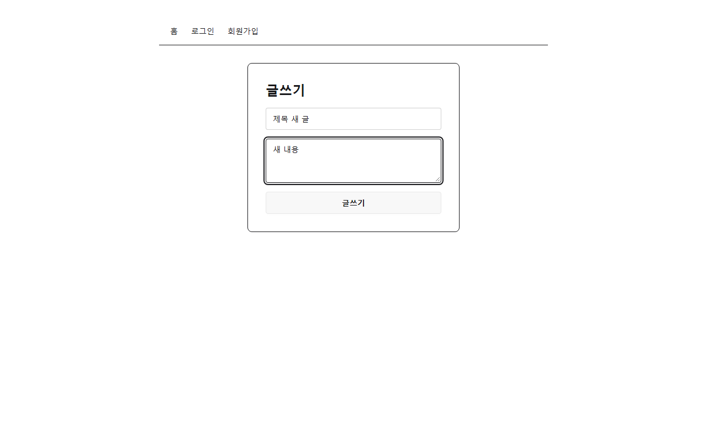

### 2. axios 인스턴스 http 만들고 앞 요청 바꾸기

왜: 모든 요청이 한 통로를 지나야 다음 단계에서 토큰을 한 번에 붙일 수 있다
실행하면: 목록, 상세, 회원가입, 로그인이 전처럼 된다. 서버 주소는 http.jsx에만 있다

#### src/pages/Detail.jsx

```diff
@@ -1,5 +1,5 @@
 import { useEffect, useState } from "react";
-import axios from "axios";
+import http from "../api/http";
 import { Link, useParams } from "react-router-dom";
 import ReplyItem from "../components/ReplyItem";
 
@@ -14,7 +14,7 @@ export default function Detail() {
 
   useEffect(() => {
     async function loadBoard() {
-      const res = await axios.get(`http://localhost:8080/api/boards/${id}`);
+      const res = await http.get(`/api/boards/${id}`);
       setBoard(res.data.body);
     }
     loadBoard();
```

#### src/pages/Home.jsx

```diff
@@ -1,5 +1,5 @@
 import { useEffect, useState } from "react";
-import axios from "axios";
+import http from "../api/http";
 import BoardCard from "../components/BoardCard";
 
 export default function Home() {
@@ -7,7 +7,7 @@ export default function Home() {
 
   useEffect(() => {
     async function loadBoards() {
-      const res = await axios.get("http://localhost:8080/?page=0");
+      const res = await http.get("/?page=0");
       setBoards(res.data.body.boards);
     }
     loadBoards();
```

#### src/pages/JoinForm.jsx

```diff
@@ -1,5 +1,5 @@
 import { useState } from "react";
-import axios from "axios";
+import http from "../api/http";
 import { useNavigate } from "react-router-dom";
 import FormCard from "../components/FormCard";
 import Input from "../components/Input";
@@ -14,7 +14,7 @@ export default function JoinForm() {
 
   async function handleSubmit(e) {
     e.preventDefault();
-    await axios.post("http://localhost:8080/join", form);
+    await http.post("/join", form);
     alert("회원가입 완료");
     navigate("/login-form");
   }
```

#### src/pages/LoginForm.jsx

```diff
@@ -1,5 +1,5 @@
 import { useState } from "react";
-import axios from "axios";
+import http from "../api/http";
 import { useNavigate } from "react-router-dom";
 import FormCard from "../components/FormCard";
 import Input from "../components/Input";
@@ -16,7 +16,7 @@ export default function LoginForm() {
 
   async function handleSubmit(e) {
     e.preventDefault();
-    const res = await axios.post("http://localhost:8080/login", form);
+    const res = await http.post("/login", form);
     const jwt = res.headers.authorization;
     login(jwt, form.username);
     navigate("/");
```

#### src/api/http.jsx

```jsx
import axios from "axios";

const http = axios.create({ baseURL: "http://localhost:8080" });

export default http;
```


### 3. 요청마다 토큰 붙이기

왜: 글쓰기처럼 로그인이 필요한 요청은 토큰이 없으면 서버가 401로 막는다
실행하면: 로그인한 뒤 홈을 열면 개발자 도구 Network 탭의 목록 요청 헤더에 Authorization: Bearer ...가 보인다

#### src/api/http.jsx

```diff
@@ -2,4 +2,12 @@ import axios from "axios";
 
 const http = axios.create({ baseURL: "http://localhost:8080" });
 
+http.interceptors.request.use((config) => {
+  const jwt = localStorage.getItem("jwt");
+  if (jwt) {
+    config.headers.Authorization = jwt;
+  }
+  return config;
+});
+
 export default http;
```


### 4. 글쓰기를 누르면 서버에 보내고 홈으로 가기

왜: 토큰이 붙는 통로가 생겼으니 글쓰기 요청만 보내면 저장된다
실행하면: 로그인하고 글을 쓰면 홈으로 가고 새 글이 목록 맨 위에 보인다

#### src/pages/SaveForm.jsx

```diff
@@ -1,16 +1,25 @@
 import { useState } from "react";
+import { useNavigate } from "react-router-dom";
+import http from "../api/http";
 import FormCard from "../components/FormCard";
 import Input from "../components/Input";
 
 export default function SaveForm() {
   const [form, setForm] = useState({ title: "", content: "" });
+  const navigate = useNavigate();
 
   function handleChange(e) {
     setForm({ ...form, [e.target.name]: e.target.value });
   }
 
+  async function handleSubmit(e) {
+    e.preventDefault();
+    await http.post("/api/boards", form);
+    navigate("/");
+  }
+
   return (
-    <FormCard title="글쓰기">
+    <FormCard title="글쓰기" onSubmit={handleSubmit}>
       <Input
         name="title"
         placeholder="제목"
```


